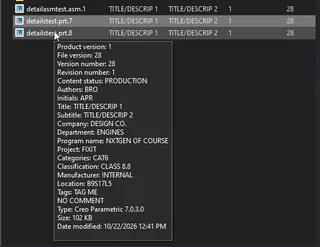
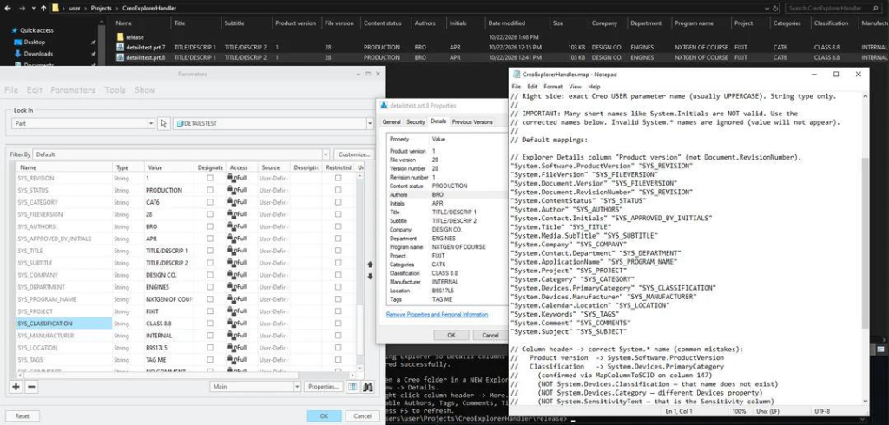

# Creo Explorer Property Handler

Read-only Windows File Explorer Details columns for Creo Parametric `.prt` / `.asm` files (including numbered iterations such as `.prt.2`).

No Creo Toolkit. No GRANITE. The handler scans the Creo PSB file for string USER parameters and never writes to the model.

> **Disclaimer — use at your own risk.** This is an AI-generated code project. It has not been reviewed in any way. You assume all risk from downloading, installing, or using this software.

## What it looks like

Explorer hover info tip with Creo properties (Classification, Manufacturer, Location, and more):



Explorer Details columns populated from Creo parameters, alongside the Creo Parameters dialog, Windows Properties Details tab, and the `CreoExplorerHandler.map` mapping file:



## Quick install (prebuilt)

From the [latest GitHub Release](https://github.com/Ballganda/creoexplorerhandler/releases), download:

- `CreoExplorerHandler.dll`
- `CreoExplorerHandler.map`
- `Register.ps1`

Put all three in one folder. Edit the `.map` if needed.

Use an elevated shell (**Run as administrator**). Developer PowerShell for Visual Studio is not elevated and will fail.

```powershell
cd C:\path\to\that\folder
Unblock-File .\Register.ps1, .\CreoExplorerHandler.dll, .\CreoExplorerHandler.map
powershell -NoProfile -ExecutionPolicy Bypass -File .\Register.ps1 -Action Register
```

Or from an Admin prompt: `Register.cmd -Action Register` (bypasses unsigned-script policy for that process only).

Then enable the mapped columns in Explorer Details (see below).

## Mapping config (`CreoExplorerHandler.map`)

Keep `CreoExplorerHandler.map` **in the same folder as the DLL**. Edit it to choose which Creo parameters fill which Explorer columns.

```text
// Comments start with //
// "Windows explorer detail header name" "CREO_PARAMETER_NAME"

"Authors" "AUTHORS"
"Tags" "TAGS"
"Comments" "COMMENTS"
"Title" "TITLE"
"Subject" "SUBJECT"
```

- Left side: Explorer header alias (`Authors`, `Company`, …) or a Windows canonical name (`System.Author`, `System.Company`, …).
- Right side: exact Creo USER parameter name (Creo stores these **UPPERCASE**). String type only.
- If the `.map` file is missing, the five defaults above are used.
- After you **add a new column name**, re-run `Register.ps1` so Explorer’s Details list includes it. Changing only the Creo parameter on an already-registered column does not need re-register: the DLL reloads the `.map` when its mtime changes (press F5 / restart Explorer if values look stale).
- The handler reads at most the first 32 MiB of each file and extracts all mapped Creo names in one scan, so large folders stay responsive.

See the header comments inside `native/CreoExplorerHandler/CreoExplorerHandler.map` for the full alias list. Use **real** Windows canonical names — short guesses like `System.Initials` or `System.ProductVersion` are not valid and are ignored (or rewritten by built-in aliases in newer DLLs). Examples of correct names: `System.Contact.Initials`, `System.Media.SubTitle`, `System.ApplicationName`, `System.Contact.Department`.

## Creo parameter contract

1. Create string USER parameters whose names match the right-hand side of your map file.
2. Use type **String**. Real/Number values are skipped.
3. Save the model. Browse the iteration you saved (for example `part.prt.2`).

## Build (Windows)

Requirements: **Visual Studio 2026** (or 2022) with workload **Desktop development with C++**. Project toolset is **v145** (VS 2026).

`msbuild` is **not** on a normal Command Prompt PATH. That error is expected in plain `cmd` — use A, B, or C below.

### Option A — Visual Studio UI (simplest with Community installed)

1. Double-click `native\CreoExplorerHandler\CreoExplorerHandler.sln`.
2. If prompted to retarget, accept the VS 2026 / v145 toolset.
3. Toolbar: **Release** | **x64**.
4. **Build → Build Solution**.
5. DLL: `native\CreoExplorerHandler\bin\Release\CreoExplorerHandler.dll`

### Option B — PowerShell helper (finds MSBuild automatically)

In normal PowerShell (no special PATH needed):

```powershell
cd path\to\repo\native\CreoExplorerHandler
.\Build.ps1
```

### Option C — Developer PowerShell for VS 2026

Start menu → **Developer PowerShell for VS 2026** (not plain `cmd`):

```powershell
cd path\to\repo\native\CreoExplorerHandler
msbuild CreoExplorerHandler.sln /p:Configuration=Release /p:Platform=x64
```

## Install / uninstall (Windows, elevated)

```powershell
cd native\CreoExplorerHandler
.\Register.ps1 -Action Register
# later:
.\Register.ps1 -Action Unregister
```

`DllRegisterServer` also runs via `regsvr32` and registers:

- `.prt`, `.asm`
- `.1` … `.99` (Windows treats `name.prt.2` as extension `.2`)

The handler ignores non-Creo files (no `#UGC:` header) and, on file-path init, ignores names that are not `.prt` / `.asm` models.

## Enable columns in Explorer

`Register.ps1` restarts Explorer after a successful register so Details columns pick up the handler. Then:

1. Open a folder of Creo files in a **new** Explorer window.
2. View → Details.
3. Right-click a column header → More…
4. Enable the columns you mapped (default: **Authors**, **Tags**, **Comments**, **Title**, **Subject**). If a name appears twice, enable both.
5. Press **F5**.

If `Verify-ExplorerProps.ps1` shows values but Explorer columns are blank, rebuild/re-register (property lists are written at register time) and allow the Explorer restart.

Optional check:

```powershell
.\Verify-ExplorerProps.ps1 -Path C:\path\to\yourpart.prt.2
```

## Extractor tests (Linux or Windows)

Portable parser used by the DLL. Point tests at your own Creo sample files (this repo does not ship `.prt` fixtures):

```bash
cd native/creo_param_extractor
cmake -S . -B build -DCMAKE_CXX_COMPILER=g++
cmake --build build
./build/dump_props /path/to/your.prt.2
```

## Risks

- Creo’s on-disk encoding is proprietary. This reader was validated against Creo 7-era part files. Later Creo versions may need extractor updates.
- Registering `.1`–`.99` attaches this handler to those extensions system-wide. Non-Creo files with those suffixes get an empty property store from this DLL.
- Do not use this DLL to write metadata; SetValue/Commit are denied on purpose.

## Layout

- `native/creo_param_extractor/` — portable C++17 extractor + tests + `dump_props`
- `native/CreoExplorerHandler/` — Windows COM property handler sources + register/verify scripts
- `release/` — prebuilt x64 DLL, default `.map`, and `Register.ps1`
